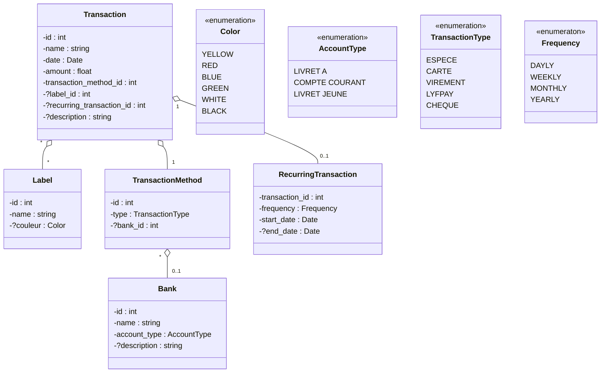

# SQLite

## C'est quoi ?
> C'est la base de données du projet, elle permet le stockage de toutes les données utilisateurs.

## Installation / mise en place

Pour l'installation, référez-vous à la [documentation de SQLite](https://sqlite.org/index.html). Si vous êtes sur fedora, vous pouvez faire la commande suivante :

```bash
sudo dnf install sqlite
```

## Utilisation dans ActaBank
> Elle permet le stockage de toutes les données de l'utilisateur, c'est à dire, la banque, les méthodes de transactions, les transactions, ...

Voici comment les données sont représentées : 

## Commandes / snippets utiles

Il n'est pas nécessaire de modifier le fichier .db de SQLite pour modifier la base de données car celle-ci est entièrement gérée par Python 
```python
# snippet fréquemment utilisé
```

## Pièges & points d'attention
> Ce qui m'a bloqué ou surpris.

## Ce que j'ai appris
> Notions découvertes, concepts compris.

## Liens
- [Documentation officielle]()

## Utilisée dans les étapes
- 
