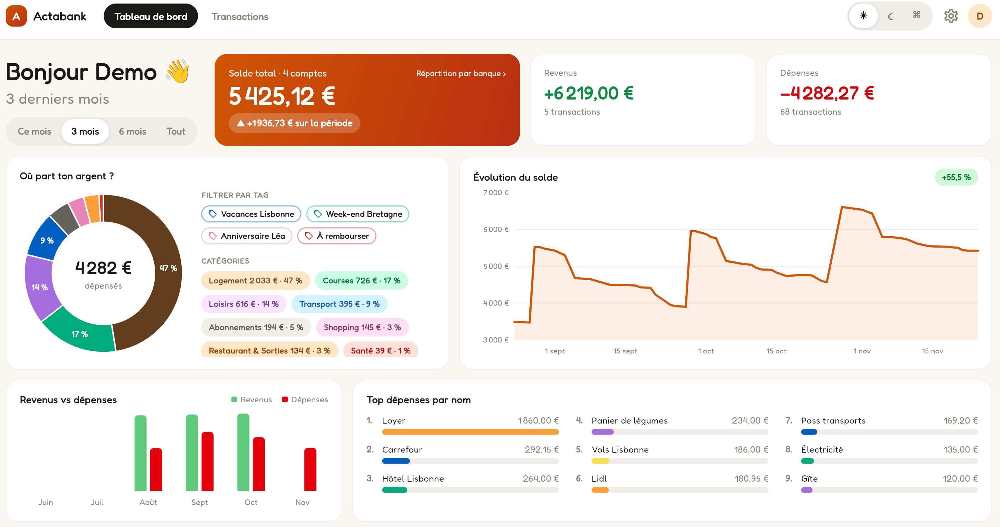
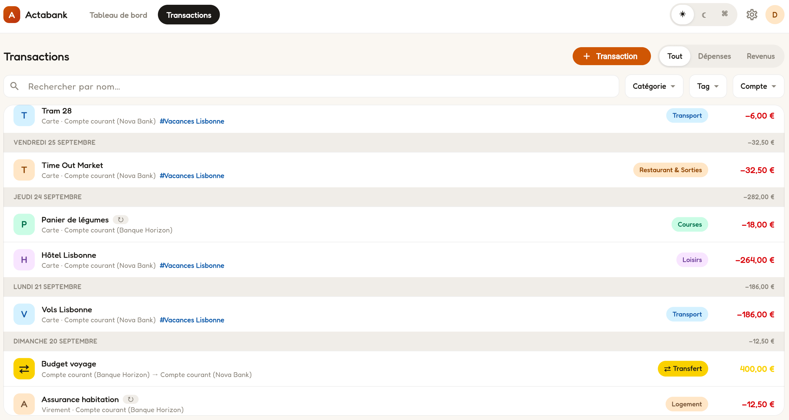
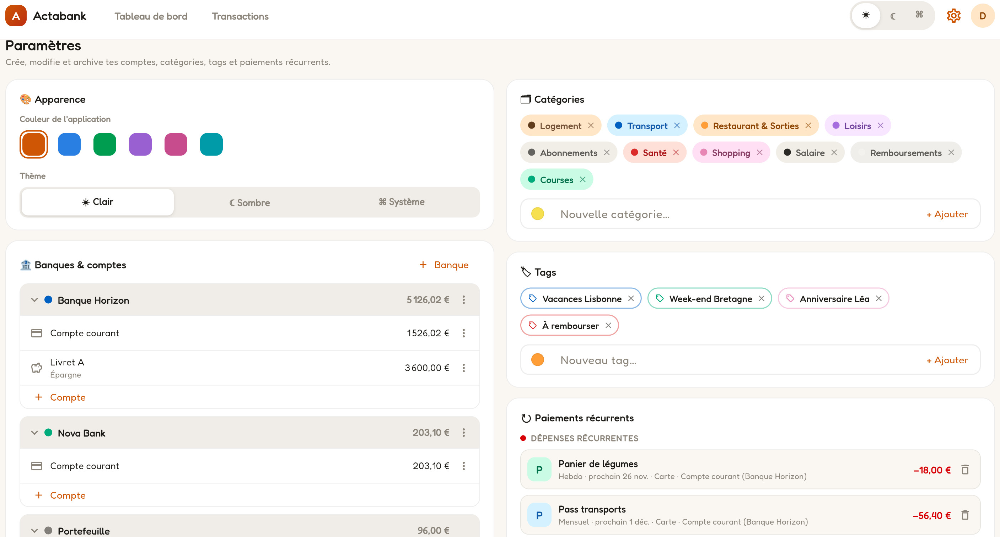
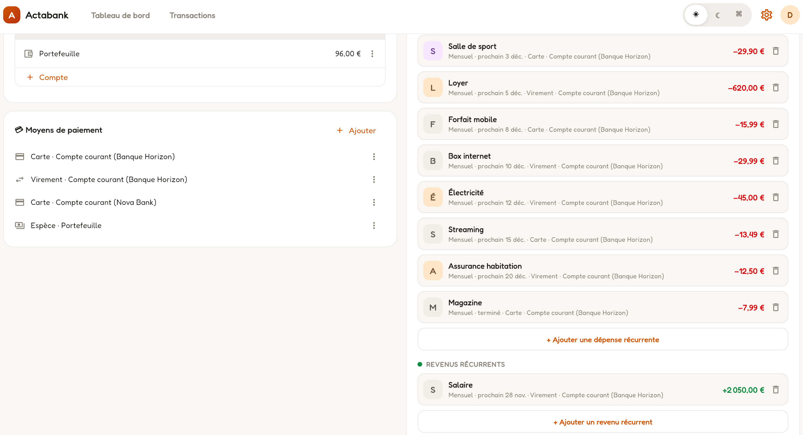
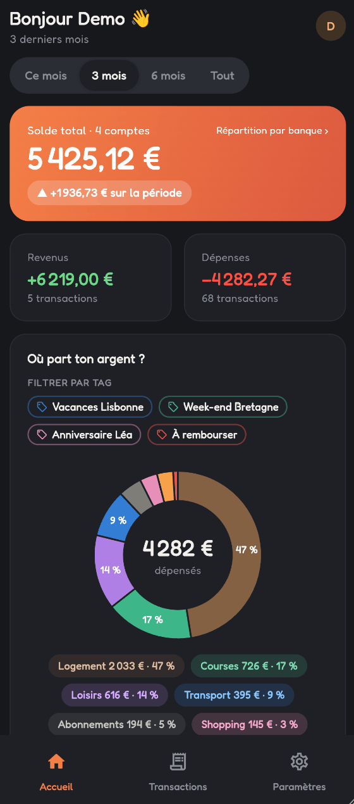
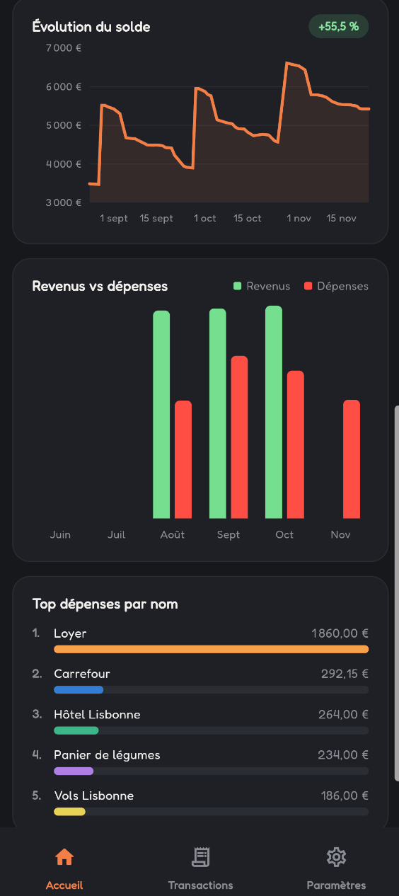
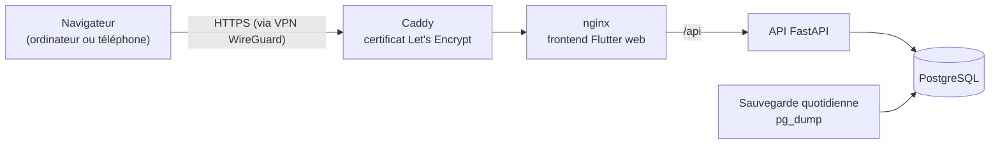

# ActaBank

> Application de gestion de comptes personnels, auto-hébergée, pour remplacer le carnet de comptes ou le fichier Excel.



<details>
<summary><b>Plus de captures</b> (transactions, paramètres, version mobile)</summary>

### Transactions


### Paramètres



### Version mobile (thème sombre)
<p>
  
  
</p>

</details>

ActaBank est un projet personnel **d'apprentissage** : chaque technologie a été choisie pour être apprise en construisant un outil réellement utilisé au quotidien, par moi et par ma famille.

## Fonctionnalités

- **Banques, comptes et moyens de paiement** (carte, virement, chèque, espèces), archivés plutôt que supprimés pour préserver l'historique
- **Transactions** avec une catégorie et plusieurs tags, recherche et filtres
- **Paiements récurrents** générés automatiquement (hebdomadaires, mensuels, annuels)
- **Transferts entre comptes**, exclus des revenus et des dépenses
- **Tableau de bord** : solde, revenus et dépenses, répartition par catégorie, évolution du solde, bilan mensuel, solde de chaque compte
- **Multi-utilisateur** : chacun ne voit que ses propres données ; inscriptions ouvrables ou fermables
- **Premiers pas** guidés pour les nouveaux utilisateurs
- Thème clair ou sombre, interface adaptée à l'ordinateur comme au téléphone

## Architecture



L'application tourne dans une stack Docker sur un serveur à domicile. Seul Caddy publie un port, et il n'est joignable qu'à travers un VPN WireGuard : rien n'est exposé sur Internet. Le nom de domaine sert uniquement à obtenir un certificat HTTPS valide, par défi DNS.

## Stack technique

| Couche | Technologies |
|---|---|
| Backend | Python, FastAPI, SQLAlchemy, Alembic, Pydantic |
| Base de données | PostgreSQL (SQLite en mémoire pour les tests) |
| Sécurité | JWT, bcrypt, données cloisonnées par utilisateur, HTTPS |
| Frontend | Flutter (web), Riverpod, dio, fl_chart |
| Déploiement | Docker, GitHub Container Registry, Portainer, Caddy, nginx |
| Accès distant | WireGuard |

## Démarrer en local

**Backend**
```bash
cd backend
cp .env.example .env          # puis renseigner les valeurs (voir backend/README.md)
docker compose up -d db       # PostgreSQL dans un conteneur
alembic upgrade head          # applique les migrations
uvicorn main:app --reload     # API sur http://127.0.0.1:8000, documentation sur /docs
```

**Frontend**
```bash
cd frontend
flutter pub get
flutter run -d web-server --web-port=8081    # http://localhost:8081
```

**Tests**
```bash
cd backend
python -m pytest
```

## Déploiement

Trois images sont publiées sur GitHub Container Registry, toujours avec le même numéro de version : `actabank-api`, `actabank-web` et `actabank-proxy`. Le tag git porte un `v`
(`v0.7.0`), le tag d'image n'en porte pas (`0.7.0`).

La stack est décrite dans [`backend/stack.yml`](backend/stack.yml). Les migrations Alembic sont appliquées automatiquement au démarrage de l'API.

| Variable | Rôle |
|---|---|
| `IMAGE_TAG` | Version des images à déployer |
| `POSTGRES_USER`, `POSTGRES_PASSWORD`, `POSTGRES_DB` | Identifiants de la base |
| `SECRET_KEY` | Clé de signature des jetons JWT |
| `ACCESS_TOKEN_EXPIRE_MINUTES` | Durée d'une session (30 minutes par défaut) |
| `REGISTRATION_OPEN` | `true` pour autoriser les inscriptions, `false` pour les fermer |
| `DOMAIN`, `DUCKDNS_TOKEN` | Nom de domaine et jeton pour le certificat HTTPS |
| `HTTPS_PORT` | Seul port publié par la stack |
| `BACKUP_DIR`, `BACKUP_KEEP_DAYS` | Dossier des sauvegardes et durée de conservation (14 jours par défaut) |

**En cas d'urgence** (jeton volé, appareil perdu) : changer `SECRET_KEY` invalide tous les jetons existants, ce qui déconnecte immédiatement tous les utilisateurs.

**Avant une migration en production** : faire une sauvegarde manuelle avec `pg_dump`, en plus de la sauvegarde quotidienne.

## Documentation

- [`backend/README.md`](backend/README.md) — API et architecture en couches
- [`backend/DATABASE.md`](backend/DATABASE.md) — modèle de données et règles d'intégrité
- [`frontend/README.md`](frontend/README.md) — application Flutter
- [`Obsidian/`](Obsidian/) — roadmap détaillée, fiches techniques et **décisions d'architecture (ADR)**

## Roadmap

Le suivi au quotidien se fait dans les [issues](../../issues) et les
[milestones](../../milestones). Les grandes étapes :

- [x] Modèle de données, API REST et logique métier testée
- [x] Authentification JWT et cloisonnement des données par utilisateur
- [x] Migration vers PostgreSQL et migrations Alembic
- [x] Frontend Flutter web (tableau de bord, transactions, paramètres)
- [x] Déploiement Docker, HTTPS, sauvegardes quotidiennes
- [x] Paiements récurrents, catégories et tags, transferts entre comptes
- [ ] Intégration continue (GitHub Actions)
- [ ] Refresh tokens
- [ ] Application Android
- [ ] Mode hors ligne (lecture, puis saisie hors ligne)
- [ ] Applications Windows et Linux
- [ ] Import de relevés bancaires

## Démarche

Ce projet a pour but de développer mes compétences sur chacune de ces technologies, avec une attention particulière à la sécurité, que je souhaite approfondir par la suite.

Je n'utilise aucun LLM qui écrive du code à ma place : je suis le seul auteur du code de cette application, et je dois en comprendre chaque ligne. J'utilise Claude Code uniquement à des fins pédagogiques, pour relire et conseiller : il est explicitement configuré pour ne pouvoir modifier aucun fichier (voir [`CLAUDE.md`](CLAUDE.md) et [`.claude/settings.json`](.claude/settings.json)).

## Licence

Distribué sous licence MIT — voir [`LICENSE`](LICENSE).