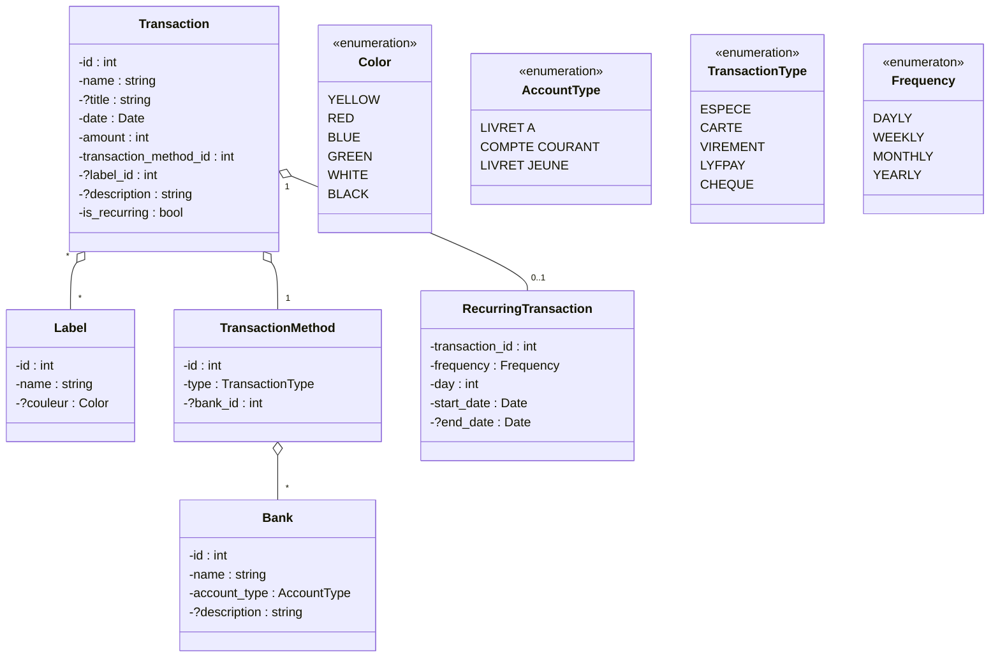

# Backend

## Diagramme représentant les données

## Routes REST API

### GET

#### Transaction

##### Get /transactions

##### Get /transactions/{trans_id}

#### Banks

##### Get /banks

#### Labels

##### Get /labels

#### Transaction Methods

##### Get /transaction_methods

### POST

### PUT

### PATCH

### DELETE

