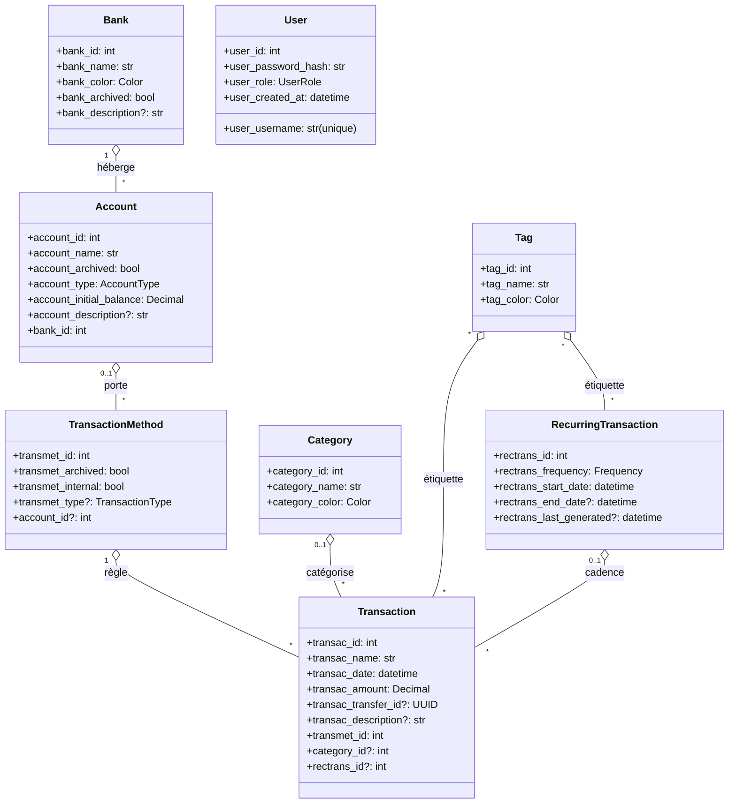

# ActaBank — Backend

API de gestion de comptes personnels : banques, comptes, moyens de paiement, transactions, catégories, tags, récurrences et transferts entre comptes, le tout cloisonné par utilisateur.

## Stack

- **Python** + **FastAPI** (documentation interactive auto sur `/docs`)
- **SQLAlchemy** (ORM) + **Alembic** (migrations)
- **PostgreSQL** (via Docker) — **SQLite** en mémoire pour les tests
- **Authentification** : JWT (PyJWT) + bcrypt
- **Tests** : pytest

## Architecture en couches

```
backend/
├── models/        # tables SQLAlchemy (la forme de la base)
├── schemas/       # schémas Pydantic (la forme du JSON de l'API)
├── crud/          # accès aux données, filtré par propriétaire
├── routes/        # endpoints HTTP, un fichier par ressource
├── services/      # logique métier transverse (génération des récurrences)
├── enums/         # énumérations (AccountType, Color, Frequency, ...)
├── alembic/       # migrations de schéma
├── tests/         # suite pytest
├── database.py    # engine, session, Base, activation FK (SQLite)
├── dependencies.py# get_db, get_current_user
├── security.py    # hachage bcrypt + création/vérification des JWT
├── config.py      # configuration typée (pydantic-settings, .env)
└── main.py        # assemblage de l'application
```

Le détail du schéma de données est documenté dans [DATABASE.md](DATABASE.md).

## Démarrer

**1. Configuration** — crée ton fichier `.env` à partir de l'exemple, puis renseigne les valeurs :

```bash
cp .env.example .env
# génère un secret JWT :        python -c "import secrets; print(secrets.token_hex(32))"
# génère un mot de passe base :  python -c "import secrets; print(secrets.token_urlsafe(24))"
```

Variables attendues :
- `SECRET_KEY`,
- `DATABASE_URL`,
- `POSTGRES_USER`, `POSTGRES_PASSWORD`, `POSTGRES_DB`
(les `POSTGRES_*` servent à Docker Compose ; `DATABASE_URL` doit reprendre les mêmes identifiants).

Variables facultatives :
- `ACCESS_TOKEN_EXPIRE_MINUTES` (durée de session, 30 par défaut),
- `REGISTRATION_OPEN` (`true` par défaut ; `false` ferme les inscriptions avec une erreur 403),
- `CORS_ORIGINS` (origines autorisées, `http://localhost:8081` par défaut, pour le développement).

**2. Lancer la base de données** :

```bash
docker compose up -d          # PostgreSQL dans un conteneur
docker compose ps             # attendre le statut (healthy)
```

**3. Appliquer les migrations** :

```bash
alembic upgrade head
```

**4. Lancer le serveur** :

```bash
uvicorn main:app --reload     # API sur http://127.0.0.1:8000
```

Documentation interactive : http://127.0.0.1:8000/docs

## Authentification

- `POST /auth/register` — crée un compte (mot de passe haché avec bcrypt)
- `POST /auth/login` — renvoie un token JWT (form-data `username` / `password`)
- `GET /auth/me` — profil de l'utilisateur connecté

Toutes les routes de ressources exigent un en-tête `Authorization: Bearer <token>`.
Chaque donnée appartient à un utilisateur : personne ne peut lire, modifier ou référencer
les données d'un autre.

## Statistiques

Routes d'agrégation pour le tableau de bord, toutes filtrées par utilisateur. Les quatre premières acceptent `?period=month|3months|6months|all` :

- `GET /stats/summary` — solde, revenus, dépenses et nombre de transactions
- `GET /stats/by-category` — dépenses par catégorie
      `?tag_id=…` restreint aux transactions portant ce tag
- `GET /stats/balance-over-time` — évolution du solde
- `GET /stats/by-name` — dépenses par libellé de transaction
- `GET /stats/monthly?months=…` — revenus et dépenses mois par mois
- `GET /stats/balances` — solde de chaque compte

Les transferts entre comptes sont **exclus** des revenus et des dépenses, mais **comptés** dans les soldes.

## Transferts entre comptes

`POST /transfers` (`from_account_id`, `to_account_id`, `amount` > 0, `transfer_date`) crée **deux transactions liées** par un identifiant commun (`transac_transfer_id`), dans
une seule transaction SQL : −montant sur le compte source, +montant sur le compte de destination.

- Chaque compte reçoit, à son premier transfert, un moyen de paiement **interne** (`transmet_internal`), invisible de toutes les routes publiques.
- Supprimer une moitié supprime le transfert entier.
- Seuls le nom et la description d'un transfert sont modifiables (sinon 409).

Choix et alternatives : voir l'ADR « Transferts entre comptes par transactions liées » dans `../Obsidian/Ressources/`.

## Tests

```bash
python -m pytest
```

La suite tourne sur une base SQLite en mémoire (via `dependency_overrides`), sans toucher à
la base de développement.

## Schéma de données



## Documents liés

- [DATABASE.md](DATABASE.md) — schéma détaillé, énumérations, règles d'intégrité
- `../CLAUDE.md` — conventions et rôle de l'assistant
- Vault Obsidian (`../Obsidian/`) — roadmap, décisions d'architecture (ADR)
